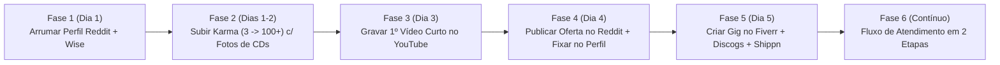

# 🚀 Playbook Passo a Passo: Do Zero ao Primeiro Cliente como *Brazil Collector Proxy*

Este guia organiza **exatamente o que fazer, em ordem cronológica**, levando em conta o estado atual da sua conta no Reddit (**`u/Former_Radio_4403`**), para você lançar o seu serviço de *Personal Shopper & Collector Proxy* do Brasil para o mundo sem se sobrecarregar.

---

## 🔍 Diagnóstico da sua Conta Atual no Reddit (`u/Former_Radio_4403`)

Analisando o print do seu perfil:
- ✅ **Ponto Fortíssimo (`4 y Reddit Age`):** Sua conta tem **4 anos de idade** e já tem interações reais em comunidades de música (`r/HIM`) e games (`r/DeathStranding`). No Reddit, idade de conta é ouro: prova imediatamente que você não é um perfil falso criado ontem.
- ⚠️ **Ponto de Atenção (`3 Karma`):** Você tem apenas **3 pontos de Karma**. Muitos subreddits bloqueiam posts de contas com menos de 10–20 de Karma pelo filtro automático (*AutoModerator*), e compradores internacionais olham o Karma e os posts anteriores para sentir confiança.
- 🎯 **Solução:** Antes de publicar a sua oferta no `r/internationalshopper`, faremos um **aquecimento rápido e divertido de 48h** usando a sua própria coleção de CDs para subir seu Karma para `50 a 150+` e já deixar vitrines reais no seu histórico!



---

## 🛠️ Fase 1: Preparar a "Vitrine" do seu Perfil no Reddit (Tempo: 15 min)

Quando um comprador estrangeiro vir um comentário ou post seu, ele vai clicar em **`u/Former_Radio_4403`**. Hoje ele vê o nome *"Architects of Fear"* e nenhuma descrição. Vamos transformar seu perfil em uma página profissional de colecionador:

- [ ] **Passo 1.1 — Atualizar Display Name e Bio no Reddit:**
  1. Na barra direita do seu perfil (onde aparece no seu print), clique no botão **`Update`** ao lado de **Profile**.
  2. Em **Display Name**, troque `Architects of Fear` por:
     ```text
     João | Brazil Collector Proxy 🇧🇷
     ```
  3. Em **About (Bio)**, cole exatamente este texto:
     ```text
     🇧🇷 Music (CD/Vinyl) & Retro Gaming Collector in Brazil. Helping international collectors buy from Mercado Livre, OLX, Enjoei & Shopee BR with IFPI authenticity checks & worldwide shipping. DM me!
     ```
  4. Mantenha sua foto de perfil real (passa muita transparência ser uma pessoa real!) e o banner do *Heartagram* do HIM (mostra que você é fã de rock/metal de verdade).
- [ ] **Passo 1.2 — Conferir Conta de Recebimento (Wise / PayPal):**
  - Certifique-se de que sua conta **Wise** (com saldo em `USD`, `GBP` e `EUR` ativado para receber transferências) e seu **PayPal** estão prontos.

---

## 🔥 Fase 2: Aquecimento de Karma (`3 Karma` → `100+ Karma`) (Tempo: Dias 1 e 2)

Em vez de postar no `r/internationalshopper` com `3 Karma`, vamos ganhar de **50 a 200 pontos de Karma** em 24–48 horas fazendo algo que você já ama: **mostrar sua coleção de CDs!**

Além de liberar sua conta em qualquer filtro do Reddit, quando um cliente futuro entrar no seu perfil para ver se você é confiável, ele vai ver fotos reais dos seus CDs com centenas de curtidas.

- [ ] **Passo 2.1 — Postar uma foto da sua coleção do HIM no `r/HIM`:**
  - Tire uma foto bem bonita dos seus CDs do **HIM** (*Razorblade Romance*, *Deep Shadows*, *Love Metal*, *Greatest Lovesongs Vol. 666*, etc.) espalhados na mesa.
  - Publique no **`r/HIM`** com o título:
    ```text
    My HIM CD collection so far here in Brazil! 🇧🇷🖤 Still hunting for more pressings!
    ```
  - *(Fãs de bandas adoram ver coleções de outros países — isso rende dezenas de upvotes fácil!).*
- [ ] **Passo 2.2 — Postar uma foto da sua coleção geral de Rock/Nu Metal no `r/Cd_collectors`:**
  - Tire uma foto com seus melhores CDs (*Linkin Park*, *System of a Down*, *Papa Roach*, *HIM*, *Incubus*, *Finch*, etc.).
  - Publique no **`r/Cd_collectors`** com o título:
    ```text
    My 2000s Rock / Nu Metal CD collection in Brazil 🇧🇷💿 What should I add next?
    ```
  - Responda aos comentários da galera em inglês (isso sobe tanto o seu *Post Karma* quanto o seu *Comment Karma*).

---

## 🎬 Fase 3: Criar o Portfólio no YouTube (Tempo: Dia 3)

Você não precisa esperar ter o primeiro cliente para ter seu vídeo de apresentação! Você pode usar **os seus próprios CDs** para demonstrar na prática como você inspeciona, troca a caixinha e embala.

- [ ] **Passo 3.1 — Criar (ou configurar) um canal no YouTube:**
  - Nome sugerido: **`Brazil Collector Proxy - João`** (ou `@BrazilCollectorProxy`).
  - Adicione o link desse canal do YouTube nos **Social Links** do seu perfil do Reddit (`Settings -> Profile -> Social Links`).
- [ ] **Passo 3.2 — Gravar o Vídeo #1 (Short de 45–60s mostrando seu padrão de embalagem):**
  - **O que filmar na mesa (com o celular na vertical):**
    1. Mostre 3 ou 4 CDs da sua coleção na mesa.
    2. Mostre você olhando a superfície do CD contra a luz e apontando para o anel central (código **IFPI**) para provar que é original.
    3. Mostre uma caixinha acrílica velha/trincada sendo trocada por uma nova brilhando.
    4. Coloque um pedacinho de plástico-bolha dentro da caixinha para travar o disco, enrole os CDs em plástico-bolha grosso, coloque na caixa de papelão em cima da balança digital.
  - **Título do YouTube Short:**
    ```text
    How I Pack Rare Brazilian CDs for International Collectors 🇧🇷✈️🌍 (Mercado Livre Proxy)
    ```
  - **Texto para falar no vídeo (ou colocar na legenda em inglês):**
    ```text
    Here is how I inspect and pack CDs from Brazil for international collectors:
    1. First, I check the IFPI matrix code and disc surface under direct light to guarantee 100% authentic pressings.
    2. Cracked jewel case from the seller? I swap it for a fresh case for free.
    3. Bubble padding inside the case so the disc never comes loose on the flight, plus heavy-duty bubble wrap and a sturdy box.
    Want to buy from Mercado Livre, OLX, or Shopee Brazil? Link in the description!
    ```
- [ ] **Passo 3.3 — Gravar o Vídeo #2 (Vídeo Horizontal de 2 a 3 minutos para ranquear na busca do Google/YouTube):**
  - **Título do Vídeo (Focado em SEO de busca):**
    ```text
    How to Buy from Mercado Livre, OLX & Shopee Brazil (Shipped to USA, UK & Worldwide) 🇧🇷📦
    ```
  - **Roteiro simples de 4 pontos (mostrando a tela do Mercado Livre/OLX ou falando para a câmera):**
    1. **O Problema (0:00–0:30):** *"If you live in the US, UK, Europe, or Japan and tried to buy rare Brazilian CDs, vinyl, TecToy retro games, or football shirts on Mercado Livre or OLX, you probably noticed two things: they require a Brazilian CPF tax ID and they reject foreign credit cards."*
    2. **Quem sou eu (0:30–1:00):** *"Hi, I'm João, a music and gaming collector based in Brazil, and I run a collector-grade personal shopper and parcel forwarding service."*
    3. **Diferencial de Colecionador (1:00–1:45):** Mostre na câmera um CD e explique a checagem de IFPI, a troca grátis de caixinha quebrada e como você negocia em português com vendedores da OLX/Mercado Livre.
    4. **Como funciona em 2 Etapas (1:45–2:30):** *"Step 1: Send me the links on Reddit or Fiverr. You pay for the items via Wise or PayPal and I buy them on the same day. Step 2: When they arrive at my place, I inspect them, consolidate multiple orders into one box for free, send you timestamped photos on the scale, and ship worldwide via tracked Correios or DHL."*

---

## 🎯 Fase 4: Publicar a "Oferta Irresistível" no Reddit (Tempo: Dia 4)

Agora que sua conta tem `4 anos`, perfil profissional, Karma alto no `r/HIM` e `r/Cd_collectors` e vídeos no YouTube, é hora de publicar sua oferta oficial!

- [ ] **Passo 4.1 — Tirar 2 Fotos de Capa com "Timestamp" (Papel Escrito à Mão):**
  - Escreva em um papel com caneta grossa:
    **`u/Former_Radio_4403 — Brazil Collector Proxy 🇧🇷`** + a data do dia.
  - **Foto 1:** O papel posicionado na frente dos seus CDs mais bonitos (HIM, Linkin Park, etc.) + alguns jogos se tiver.
  - **Foto 2:** O papel ao lado de uma caixa de envio, plástico-bolha e balança digital.
- [ ] **Passo 4.2 — Publicar no `r/internationalshopper` (e também no seu próprio Perfil e clicar em *"Pin to Profile"*):**

#### Título do Post:
```text
[Offer] 🇧🇷 Brazil Personal Shopper & Collector-Grade Proxy (Mercado Livre, OLX, Enjoei, Shopee BR) — Music (CDs/Vinyl), Retro Games (TecToy/Playtronic) & More!
```

#### Corpo do Post (Copie e Cole):
```markdown
Hey everyone! 👋

I’m João (`u/Former_Radio_4403`), a dedicated **Music (CD/Vinyl) & Gaming collector based in Brazil**, and I’m opening up slots to help international buyers and fellow collectors purchase from Brazilian-only marketplaces that require a local **CPF** and **Brazilian payment methods (Pix / local cards)**.

If you’ve ever tried buying from **Mercado Livre, OLX, Enjoei, Shopee Brazil, or Estante Virtual**, you know it’s basically impossible without a local resident. I’m here to bridge that gap — with the eye and care of an actual collector.

---

### 🎸🕹️ Why Use My Service? (By a Collector, For Collectors)

Most general forwarders just toss sealed mailers into a box. If a local seller sends a bootleg CD, a scratched disc, or a repro game cartridge, you only find out weeks later when it arrives at your door. **I do things differently:**

1. **🔍 Free Collector-Grade Authenticity & Condition Check:**
   - **Music (CDs, Vinyl, Cassettes, Box Sets):** I personally inspect the **IFPI / Matrix codes** to guarantee 100% official factory pressings (no bootlegs/CD-Rs), check booklets for mold/water damage, and send you high-res photos of the disc surface under direct light.
   - **Retro & Modern Games (TecToy Master System/Mega Drive, Playtronic Nintendo, PS1/PS2/Big Box PC):** I verify labels, manuals, boxes, and authenticity before shipping overseas, and I can negotiate directly in Portuguese with local sellers on OLX/Mercado Livre to ask for extra photos before we even buy.
2. **💿 Free "Fresh Jewel Case" Upgrade (On Request):**
   - If a used CD arrives from a Brazilian seller with a cracked or broken standard jewel case, I’ll swap it for a clean, intact jewel case **for free** before shipping it to you.
3. **🛡️ "Bombproof" Collector Packaging:**
   - I pack the way I want my own grails packed: bubble-insert padding *inside* cases so discs don't pop loose in transit, corner protection, and tight outer boxing to minimize volumetric weight.
4. **📦 Beyond Music & Games:**
   - While music and games are my specialty, I’m happy to source & forward **anything legal from Brazil**: Brazilian football shirts, perfumes/cosmetics (Natura, O Boticário, Granado), books, vintage toys (Estrela, Glasslite), clothes from Enjoei, etc.

---

### 🔒 100% Transparent 2-Step Process (Zero Guesswork)

1. **Step 1 — Assisted Purchase:** Send me the links from Mercado Livre, OLX, Enjoei, or Shopee BR. I’ll reply with a clear breakdown of the item cost + domestic shipping + my service fee. Once paid, I purchase the item immediately and send you the order screenshot.
2. **Step 2 — Inspection, Consolidation & International Shipping:** When your items arrive, I send you **timestamped photos with your Reddit username**, the exact weight on a digital scale, and official shipping quotes (**Correios International Tracked** or **DHL/FedEx**). You only pay for international shipping once everything is packed, weighed, and approved by you!

* **Free Storage:** Up to **45 days** so you can build a bundle from multiple sellers and save on international shipping.

---

### 🚀 Special Launch Offer (First 5 Reddit Clients!)

To build my initial verified review thread here on `r/internationalshopper`, my **first 5 clients** get:
- **Flat $8 USD (or £6 / €7) service fee** on orders up to $80 USD (normally 12% / $12 min).
- **FREE consolidation** of up to **4 packages** into one single box (removing bulky outer packaging to keep your international postage as low as possible).

💳 **Payment Methods Accepted:** Wise (preferred — lowest fees & best exchange rate), Revolut, or PayPal.

Drop a comment below or send me a **Chat / DM** with the links you’re hunting for, and I’ll be happy to get you a free quote! 🇧🇷✈️🌍
```

---

## 🌐 Fase 5: Abrir as Outras 3 Portas de Entrada (Tempo: Dia 5)

Com o post do Reddit e o vídeo do YouTube prontos, basta replicar a mesma estrutura em 3 lugares onde os clientes buscam todos os dias:

- [ ] **Passo 5.1 — Criar seu Anúncio (*Gig*) no Fiverr (`fiverr.com`):**
  - **Título do Gig:** `I will be your personal shopper and collector proxy in Brazil Mercado Livre OLX`
  - **Categoria:** *Lifestyle -> Personal Styling / Shopping* (ou *Business -> Virtual Assistant / Sourcing*).
  - **Pacotes do Fiverr:**
    - **Basic (`$10`):** Compra assistida + inspeção de 1 pedido (Mercado Livre / OLX / Shopee BR) + fotos de verificação *(o valor do produto e do frete é cobrado via Custom Offer / adição no pedido)*.
    - **Standard (`$20`):** Compra assistida e consolidação de até 3 pacotes de vendedores diferentes + inspeção IFPI/Games + troca de *Jewel Case*.
    - **Premium (`$35`):** *Hunter & Consolidation Pack* — Pesquisa ativa de itens raros no Brasil, negociação em português na OLX/ML e consolidação de até 6 pacotes.
  - **Vídeo do Gig:** Suba o mesmo vídeo horizontal de 2 minutos que você gravou na Fase 3 (anúncios com vídeo no Fiverr vendem até 3x mais!).
- [ ] **Passo 5.2 — Atualizar sua Bio no Discogs (`discogs.com`):**
  - No seu perfil do Discogs, adicione:
    ```text
    🇧🇷 BRAZIL COLLECTOR PROXY: Looking for rare Brazilian CD/Vinyl pressings on Mercado Livre, OLX, Enjoei, or Shopee Brazil? Message me! I offer assisted purchases, IFPI matrix verification, free jewel case replacement, and consolidated worldwide tracked shipping.
    ```
- [ ] **Passo 5.3 — Cadastrar-se como *Host* na Shippn (`shippn.com/en/become-a-host`):**
  - Cadastro gratuito para receber pedidos automáticos de *"Buy For Me"* da plataforma.

---

## 📦 Fase 6: Rotina de Atendimento quando o 1º Cliente Chamar

Para não ter erro quando o primeiro gringo te mandar mensagem no Reddit ou no Fiverr:

1. **Cliente manda o link do Mercado Livre / OLX:**
   - Confira se o vendedor do ML tem boa reputação e calcule o frete até o seu CEP (`36800-112`).
   - Simule rapidamente o peso estimado no portal **[Minhas Exportações dos Correios](https://minhasexportacoes.correios.com.br/simulacao)** só para já dar uma ideia aproximada de quanto vai custar o frete internacional na Etapa 2 (os gringos adoram saber a estimativa antes!).
2. **Envie o Orçamento da Etapa 1 (Texto pronto em inglês):**
   ```text
   Awesome find! Here is the breakdown for Step 1 (Purchase):
   - Item price on Mercado Livre: R$ XX,XX (~$XX.XX USD)
   - Domestic shipping to my address in Brazil: R$ XX,XX (~$X.XX USD)
   - Launch Promo Service Fee (includes IFPI check & consolidation): $8.00 USD
   -----------------------------------------
   Total for Step 1: $XX.XX USD (via Wise or PayPal)

   (Note: For Step 2, once the item arrives and is packed, estimated international tracked shipping to [Country] for ~[Weight]g via Correios is around $XX–$XX USD).

   As soon as Step 1 is paid, I'll buy it right away and send you the order confirmation screenshot!
   ```
3. **Recebeu o Pagamento 1 → Compra no ML → Manda o Print.**
4. **Chegou em Carangola → Inspeciona → Tira foto com o nome dele → Pesa na balança → Gera a pré-postagem no *Minhas Exportações* → Recebe o Pagamento 2 → Posta nos Correios e pede o *Review* no `r/internationalshopper`!**
