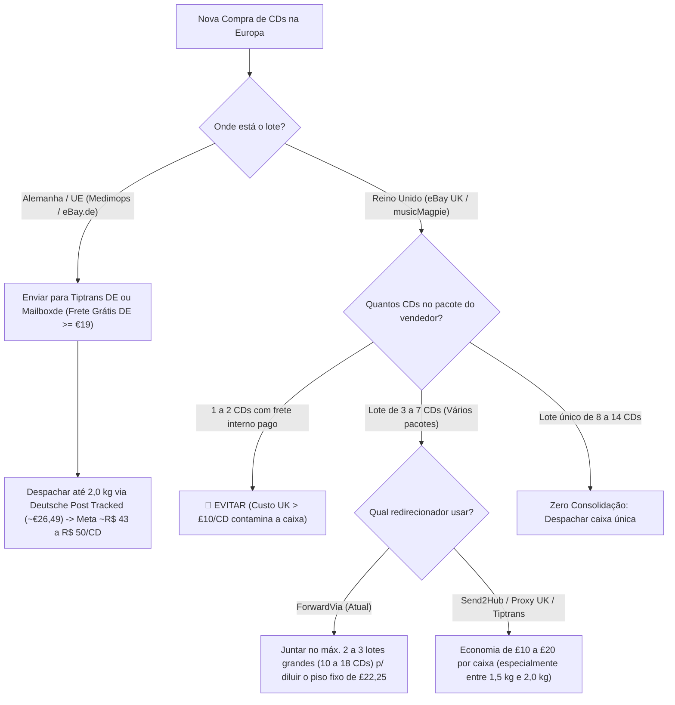

# 📦 Relatório de Inteligência Logística: Redirecionadores (UK/Europa), Tarifas Postais e Matemática de Consolidação de CDs

Este documento consolida todas as análises matemáticas, auditorias do histórico real de importações do projeto ([`tracker-db.json`](file:///Users/joaoalbertofn/Documents/Cd-importer-tracker/data/tracker-db.json)), a **engenharia reversa exata da calculadora da ForwardVia** e o benchmark de redirecionadores e tarifas postais da Europa (Reino Unido e Alemanha) para o Brasil (**Carangola/MG — CEP `36800-112`**).

Pode ser utilizado tanto como guia estratégico de compras quanto como **contexto de referência para outros agentes de IA** que atuem nas regras de domínio ([`calculations.ts`](file:///Users/joaoalbertofn/Documents/Cd-importer-tracker/src/lib/calculations.ts) e [`consolidationAdvisor.ts`](file:///Users/joaoalbertofn/Documents/Cd-importer-tracker/src/lib/domain/consolidationAdvisor.ts)).

---

## 1. Engenharia Reversa da ForwardVia vs. Tarifa Oficial da Royal Mail (UK → Brasil)

Enquanto no balcão dos correios britânicos (Post Office / Click & Drop varejo) a Royal Mail cobra por degraus de `250g / 500g`, a **ForwardVia utiliza uma tabela corporativa linear por `100g` (`0,1 kg`)** somada à sua própria margem operacional.

### 1.1. A Fórmula Exata da Calculadora da ForwardVia (Brasil — CEP `36800-112`)

A partir das **9 simulações reais** extraídas diretamente da calculadora da ForwardVia (`0,2 kg`, `0,3 kg`, `0,4 kg`, `0,5 kg`, `0,8 kg`, `1,3 kg`, `1,5 kg`, `1,7 kg` e `2,0 kg`), fica comprovada com **100% de exatidão nos centavos** a equação linear que a ForwardVia utiliza para o Brasil:

- **Fórmula `Royal Mail STANDARD (Partially Trackable)` na ForwardVia:**
  $$\text{Frete Standard (£)} = \text{round}\left(22,255 + 14,697 \times \text{Peso em kg},\ 2\right)$$
  *(Taxa base fixa de **`£22,26`** + acréscimo constante de **`+£1,47` a cada `100g`**).*
- **Fórmula `Royal Mail ECONOMY (No Tracking)` na ForwardVia:**
  $$\text{Frete Economy (£)} = \text{round}\left(14,132 + 17,649 \times \text{Peso em kg},\ 2\right)$$
  *(Taxa base fixa de **`£14,13`** + acréscimo constante de **`+£1,765` a cada `100g`**).*

### 1.2. Tabela Completa de `100g` em `100g` (`0,1 kg` a `2,0 kg`): ForwardVia vs. Royal Mail Oficial

*(Os valores marcados com 📸 foram verificados diretamente nas capturas de tela da calculadora da ForwardVia para Carangola/MG `36800-112`).*

| Peso (`kg`) | Qtd. Estimada de CDs (~100g–110g) | ForwardVia **Economy** *(Sem Rastreio)* | ForwardVia **Standard** *(Com Rastreio)* | Tarifa Oficial Royal Mail Varejo (*Tracked*) | Ágio da ForwardVia (*Standard vs Oficial*) | **Frete ForwardVia Standard por CD** *(câmbio £1 = R\$ 7,10)* |
| :---: | :---: | :---: | :---: | :---: | :---: | :---: |
| **`0,1 kg`** | 1 CD | `£15,90` | `£23,73` | `~£19,50` | `+£4,23` | `£23,73 / CD` (**`R$ 168,48 / CD`**) |
| **`0,2 kg`** 📸 | 1 a 2 CDs | **`£17,66`** | **`£25,20`** | `~£19,50` | `+£5,70` | `£12,60 / CD` (**`R$ 89,46 / CD`**) |
| **`0,3 kg`** 📸 | 2 a 3 CDs | **`£19,43`** | **`£26,67`** | `~£23,50` | `+£3,17` | `£8,89 / CD` (**`R$ 63,12 / CD`**) |
| **`0,4 kg`** 📸 | 3 a 4 CDs | **`£21,19`** | **`£28,14`** | `~£23,50` | `+£4,64` | `£7,04 / CD` (**`R$ 49,95 / CD`**) |
| **`0,5 kg`** 📸 | 4 a 5 CDs | **`£22,96`** | **`£29,61`** | `~£23,50` | `+£6,11` | `£5,92 / CD` (**`R$ 42,05 / CD`**) |
| **`0,6 kg`** | 5 a 6 CDs | `£24,72` | `£31,08` | `~£27,50` | `+£3,58` | `£5,18 / CD` (**`R$ 36,78 / CD`**) |
| **`0,7 kg`** | 6 a 7 CDs | `£26,49` | `£32,55` | `~£27,50` | `+£5,05` | `£4,65 / CD` (**`R$ 33,02 / CD`**) |
| **`0,8 kg`** 📸 | 7 a 8 CDs | **`£28,25`** | **`£34,01`** | `£30,55` | `+£3,46` | `£4,25 / CD` (**`R$ 30,18 / CD`**) |
| **`0,9 kg`** | 8 a 9 CDs | `£30,02` | `£35,48` | `£30,55` | `+£4,93` | `£3,94 / CD` (**`R$ 27,99 / CD`**) |
| **`1,0 kg`** | 9 a 10 CDs | `£31,78` | **`£36,95`** | `£30,55` | `+£6,40` | `£3,70 / CD` (**`R$ 26,23 / CD`**) |
| **`1,1 kg`** | 10 CDs | `£33,55` | `£38,42` | `£33,70` | `+£4,72` | `£3,84 / CD` (**`R$ 27,28 / CD`**) |
| **`1,2 kg`** | 11 CDs | `£35,31` | `£39,89` | `£33,70` | `+£6,19` | `£3,63 / CD` (**`R$ 25,75 / CD`**) |
| **`1,3 kg`** 📸 | 11 a 12 CDs | **`£37,08`** | **`£41,36`** | `£35,90` | `+£5,46` | `£3,45 / CD` (**`R$ 24,47 / CD`**) |
| **`1,4 kg`** | 12 a 13 CDs | `£38,84` | `£42,83` | `£35,90` | `+£6,93` | `£3,29 / CD` (**`R$ 23,39 / CD`**) |
| **`1,5 kg`** 📸 | 13 a 14 CDs | **`£40,61`** | **`£44,30`** | `£35,90` | `+£8,40` | `£3,16 / CD` (**`R$ 22,47 / CD`**) |
| **`1,6 kg`** | 14 a 15 CDs | `£42,37` | `£45,77` | `£36,90` | `+£8,87` | `£3,05 / CD` (**`R$ 21,66 / CD`**) |
| **`1,7 kg`** 📸 | 15 a 16 CDs | **`£44,14`** | **`£47,24`** | `£36,90` | `+£10,34` | `£2,95 / CD` (**`R$ 20,96 / CD`**) |
| **`1,8 kg`** | 16 a 17 CDs | `£45,90` | `£48,71` | `£36,90` | `+£11,81` | `£2,87 / CD` (**`R$ 20,34 / CD`**) |
| **`1,9 kg`** | 17 CDs | `£47,67` | `£50,18` | `£36,90` | `+£13,28` | `£2,95 / CD` (**`R$ 20,96 / CD`**) |
| **`2,0 kg`** 📸 | 18 CDs | **`£49,43`** | **`£51,65`** | `£36,90` | `+£14,75` | `£2,87 / CD` (**`R$ 20,37 / CD`**) |

> [!IMPORTANT]
> **As 3 Conclusões Matemáticas da Fórmula Real da ForwardVia (`£22,25 + £14,70/kg`):**
> 1. **A cobrança na ForwardVia é linear a cada `100g` (`+£1,47`):** Diferente do correio de balcão (que cobra degraus fechados de 250g/500g), na ForwardVia cada `100g` adicionais (~1 CD) soma exatamente **`+£1,47` (`~R$ 10,44`)** ao frete internacional. Portanto, **não há "peso desperdiçado"** em `1,3 kg`: você paga exatamente por `1,3 kg` (`£41,36`).
> 2. **O verdadeiro "pedágio fixo" de cada envio na ForwardVia é `£22,25` (`~R$ 158,00`):** Antes de colocar o primeiro grama na caixa, a ForwardVia já parte de um piso fixo de **`£22,25`**. É por isso que:
>    - Em uma caixa de **4 CDs (`0,5 kg`)**, só esse piso fixo de `£22,25` custa **`£5,56` (`R$ 39,49`) por CD**.
>    - Em uma caixa de **10 CDs (`1,0 kg`)**, o piso fixo cai para **`£2,23` (`R$ 15,80`) por CD**.
>    - Em uma caixa de **14 CDs (`1,5 kg`)**, o piso fixo cai para **`£1,59` (`R$ 11,28`) por CD**.
>    - Em uma caixa de **18 CDs (`2,0 kg`)**, o piso fixo cai para **`£1,24` (`R$ 8,78`) por CD**.
> 3. **Acima de `1,5 kg`, o ágio da ForwardVia sobre a Royal Mail dispara:** Na tabela oficial da Royal Mail, o frete quase congela entre `1,5 kg` (`£35,90`) e `2,0 kg` (`£36,90`), subindo apenas `+£1,00`. Já a ForwardVia continua cobrando `+£1,47` a cada `100g` até chegar em **`£51,65`** nos `2,0 kg` (**`£14,75` de lucro/ágio sobre a tarifa postal oficial**). Isso significa que, para caixas pesadas (`1,5 kg a 2,0 kg`), usar um redirecionador que cobre a tarifa oficial da Royal Mail economiza até **`£15` (`~R$ 106`) só no frete**!

---

## 2. Benchmark de Redirecionadores do Reino Unido (UK → Brasil) e Auditoria Real do Send2Hub

Empresas como **Forward2Me**, **Planet Express UK** e **MyUKMailbox** operam prioritariamente com couriers expressos (DHL, FedEx, UPS) para o Brasil (`£85 a £140+`), o que inviabiliza a importação de CDs baratos.

### 2.1. Descoberta nas Simulações Reais do Send2Hub (`send2hub.com/shipping-calc`) 📸

Nas 5 capturas de tela da calculadora do **Send2Hub** para o Brasil (`ROYAL MAIL / EVRI / SPRING TRACKED`, com rastreio `YES` e seguro incluso de até `£50,00`), os valores reais cotados foram:
- **Para `0,3 kg`, `0,5 kg` e `1,0 kg` (com caixa `20 × 20 × 20 cm`):** **`£25,71`** (`~R$ 182,54`)
- **Para `2,0 kg` (com caixa `20 × 20 × 20 cm`):** **`£28,18`** (`~R$ 200,08`)

> [!TIP]
> **Por que `0,3 kg`, `0,5 kg` e `1,0 kg` deram exatamente os mesmos `£25,71` no Send2Hub?**
> Repare no último campo à direita da calculadora do Send2Hub: **`Volumetric Weight(kg): 1.6`**.
> O Send2Hub calcula o peso volumétrico pela fórmula padrão de aviação:
> $$\text{Peso Volumétrico (kg)} = \frac{\text{Comprimento} \times \text{Largura} \times \text{Altura (cm)}}{5000}$$
> Como nas simulações as medidas estavam em `20 × 20 × 20 cm` ($\frac{8000}{5000} = 1,6\text{ kg}$), qualquer pacote de `0,1 kg` até `1,6 kg` dentro de uma caixa `20 × 20 × 20 cm` é cobrado como **`1,6 kg` (`£25,71`)**!
> - Quando você subiu o peso físico para **`2,0 kg`** (superando os `1,6 kg` volumétricos), o preço subiu apenas **`+£2,47`**, fechando em impressionantes **`£28,18`**!
> - Se a caixa consolidada de 9–10 CDs for mais achatada (ex.: `25 × 15 × 12 cm` = peso volumétrico de **`0,9 kg`**), o frete de `1,0 kg` no Send2Hub cai ainda mais (para cerca de **`~£22,00`**)!
> - Curiosamente, no Send2Hub o envio **Com Rastreio (`Tracked`: `£25,71` / `£28,18`) é mais barato que o Sem Rastreio (`Untracked`: `£28,54` / `£34,07`)** devido ao contrato corporativo deles com a malha *Royal Mail / Spring GDS*.

### 2.2. Comparativo Direto Auditado: Send2Hub vs. ForwardVia (Valores Reais de Tela 📸)

| Peso / Caixa Consolidada (3 pacotes c/ *repack*) | **ForwardVia** (Frete Standard + `£10,80` Consolidação) | **Send2Hub** (Frete Tracked + `£0,00` Consolidação) | **Economia Direta no Send2Hub por Caixa** *(câmbio £1 = R\$ 7,10)* |
| :--- | :---: | :---: | :---: |
| **`1,0 kg` (~10 CDs)** *(caixa 20×20×20 = 1,6 kg vol.)* | `£36,95 + £10,80` = **`£47,75`** (`R$ 339,03`) | **`£25,71 + £0,00 = £25,71`** (`R$ 182,54`) | **Economia de `£22,04` (`R$ 156,48`)** (-46%) |
| **`1,5 kg` (~14 CDs)** *(caixa 20×20×20 = 1,6 kg vol.)* | `£44,30 + £10,80` = **`£55,10`** (`R$ 391,21`) | **`£25,71 + £0,00 = £25,71`** (`R$ 182,54`) | **Economia de `£29,39` (`R$ 208,67`)** (-53%) |
| **`2,0 kg` (~18 CDs)** *(caixa 20×20×20)* | `£51,65 + £10,80` = **`£62,45`** (`R$ 443,40`) | **`£28,18 + £0,00 = £28,18`** (`R$ 200,08`) | **Economia de `£34,27` (`R$ 243,32`)** (-55%) |

### 2.3. Tabela Geral dos Redirecionadores do UK que Enviam via Rede Postal (Royal Mail / Spring)

| Posição & Redirecionador (UK) | Taxa de Entrada | Consolidação (3 pacotes c/ *repack*) | Frete Rastreado (**1,0 kg / 1,5 kg / 2,0 kg**) | **Custo Total UK (1,0 kg)** | **Custo Total UK (1,5 kg)** | **Custo Total UK (2,0 kg)** | Perfil Ideal de Uso |
| :--- | :---: | :---: | :---: | :---: | :---: | :---: | :--- |
| **1º Send2Hub** (`send2hub.com`) 📸 | `£0,00` | **`£0,00` (Grátis)** no plano Individual (`£0/mês`) | **`£25,71` / `£25,71` / `£28,18`** *(Cotação real caixa 20×20×20)* | **`£25,71`** (`R$ 183`) | **`£25,71`** (`R$ 183`) | **`£28,18`** (`R$ 200`) | 🏆 **Campeão absoluto no UK:** custa menos da metade da ForwardVia em 1,5–2,0 kg e tem consolidação grátis. |
| **2º Proxy Independente UK (`u/KingBenneth` — Reddit)** | `£0,00` | **`£0,00` (Grátis)** até 4 pacotes pequenos | **`£30,55` / `£35,90` / `£36,90`** *(Tarifa oficial s/ markup)* | **`~£35,55`** *(c/ £5 comissão)* (`R$ 252`) | **`~£40,90`** *(c/ £5 comissão)* (`R$ 290`) | **`~£41,90`** *(c/ £5 comissão)* (`R$ 297`) | 🥈 **Ótima opção pessoa física:** usa o *Click & Drop* oficial sem cobrança de peso volumétrico. |
| **3º Tiptrans UK** (Liverpool — `L20 4DY`) | `£0,00` | **`$5,00` (`~£4,00`) fixo** pela caixa toda + `$5,00` (`~£4,00`) despacho | `~£32,00` / `~£37,50` / `~£40,00` | **`~£40,00`** (`R$ 284`) | **`~£45,50`** (`R$ 323`) | **`~£48,00`** (`R$ 341`) | 👍 **Bom para juntar 4 a 6+ pacotes**, pois a consolidação é **fixa (`$5` no total)** e não por pacote. |
| **4º Shopogolic UK** (`shopogolic.net`) | **`£2,50 / pct`** (`£7,50` p/ 3 pcts) | **`£0,00` (Grátis)** | `~£33,50` / `~£39,00` / `~£42,00` | **`~£41,00`** (`R$ 291`) | **`~£46,50`** (`R$ 330`) | **`~£49,50`** (`R$ 351`) | A taxa de entrada de `£2,50` por pacote recebido reduz a vantagem da consolidação grátis. |
| **5º Forwardvia** (`forwardvia.com` — *Atual*) 📸 | `£0,00` | **`£3,60 / pct`** (`£10,80` p/ 3 pcts) | **`£36,95` / `£44,30` / `£51,65`** *(Valores exatos da calculadora)* | **`£47,75`** (`R$ 339`) | **`£55,10`** (`R$ 391`) | **`£62,45`** (`R$ 443`) | ⚠️ **Quase o dobro do Send2Hub:** cobra `£3,60/pct` + piso de `£22,26` + `+£14,70/kg` linear. |
| **6º UK Postbox** (`ukpostbox.com`) | **`£5,00 a £6,00 / pct`** (no plano grátis PAYG) | `£1,80 a £3,00` + taxa de reembalagem | `~£32,50` / `~£38,00` / `~£40,00` | **`~£52,00+`** (`R$ 369+`) | **`~£58,00+`** (`R$ 412+`) | **`~£60,00+`** (`R$ 426+`) | ❌ **Inviável no plano gratuito (PAYG):** cobra de `£5 a £6` apenas para receber cada pacote no armazém. |

> [!WARNING]
> **Regras de Segurança Operacional no Redirecionador:**
> - **Nunca utilize `Royal Mail Economy (No Tracking)`:** A diferença para o *Standard* cai de `£4,28` (em `1,3 kg`) para apenas **`£2,22` (em `2,0 kg`)**, mas o pacote entra no Brasil sem código rastreável registrado (`L...GB`, `R...GB` ou `C...GB`), impedindo a vinculação automática ao CPF no portal *Minhas Importações* dos Correios e elevando drasticamente o risco de extravio.
> - **Não transfira pacotes já consolidados entre redirecionadores dentro do UK (ex.: Forwardvia → Tiptrans Liverpool):** O envio doméstico dentro do Reino Unido ativa a cobrança obrigatória de **+20% de UK VAT** sobre o frete e taxas internas, além de travas de verificação antifraude (Cláusula 3.17 da Forwardvia), saindo mais caro que enviar direto ao Brasil.

---

## 3. Alternativa Europeia de Baixo Custo: Alemanha (Deutsche Post / DHL)

Para pacotes de **1,0 kg a 2,0 kg**, o correio oficial da Alemanha (**Deutsche Post / DHL Alemanha**) possui a tarifa postal rastreada mais barata da Europa para o Brasil, custando **menos da metade do preço da ForwardVia em 1,5 kg – 2,0 kg**.

### 3.1. Tarifas Oficiais Deutsche Post / DHL Alemanha → Brasil (`36800-112`)

| Modalidade (Alemanha → Brasil) | Limite de Peso e Dimensões | Tarifa Oficial Online (EUR) | Equivalente em GBP / BRL (`€1 ≈ R$ 6,25`) | Rastreio e Seguro |
| :--- | :---: | :---: | :---: | :--- |
| **DHL Päckchen International M** | **Até 2,0 kg** ($L+W+H \le 90\text{ cm}$) | **`€ 22,49`** | `~£19,00` / **`~R$ 140,50`** | Básico (contratável rastreio/seguro adicional) |
| **DHL Paket International / Weltpaket** | **Até 2,0 kg** (máx. $60 \times 30 \times 15\text{ cm}$) | **`€ 26,49`** | `~£22,30` / **`~R$ 165,50`** | **Rastreio completo fim a fim + Seguro de até € 500** |

### 3.2. Redirecionadores na Alemanha (Hub de Zittau) e Fontes de Compra

1. **Tiptrans Alemanha** (mesma conta já utilizada no UK):
   - Endereço gratuito na Alemanha (Zittau).
   - Taxa de consolidação fixa: **`$5,00` pela caixa consolidada** (independente do número de pacotes) + **`$5,00`** de despacho.
   - Envio via **Deutsche Post Priority / Registered** para o Brasil (`1,0 kg a 2,0 kg`) fica na faixa de **`€ 26 a € 32` (`R$ 162 a R$ 200`)**.
2. **Mailboxde.com** (`mailboxde.com`):
   - Referência na Alemanha; cobra taxa de processamento (`~€ 3,85` até 2 kg) + declaração alfandegária Non-EU (`€ 2,20`) + taxa por item consolidado, despachando via **Deutsche Post Weltpaket Tracked**.
3. **Melhores lojas para abastecer o endereço alemão com frete interno grátis:**
   - **Medimops (`medimops.de` / loja oficial no `eBay.de`):** Maior acervo de CDs usados da Europa (equivalente à *musicMagpie* / *World of Books* do UK), com CDs de Rock/Metal entre **`€ 1,50 e € 3,50`** e **frete doméstico grátis na Alemanha a partir de `€ 19,00`** (enviado em pacote único, eliminando custos de consolidação).

---

## 4. Matemática da Consolidação Corrigida (`R$ 43 a R$ 70 / CD`)

Aplicando as Regras 1 a 4 de [`calculations.ts`](file:///Users/joaoalbertofn/Documents/Cd-importer-tracker/src/lib/calculations.ts#L117-L240) com a **fórmula real auditada da ForwardVia (`£22,25 + £14,70 × kg`)**, câmbio de referência `£1 = R$ 7,10` e fator de imposto de Minas Gerais (`MG_TAX_FACTOR = 0,9277` sobre o valor dos CDs):

$$\text{Custo Final por CD (BRL)} = \frac{\left(\text{CDs} \times 1,9277 + \text{Frete Interno} + \text{Taxa Consolidação} + \text{Frete Internacional}\right) \times \text{Câmbio}}{\text{Quantidade Total de CDs}}$$

### 4.1. Comparativo de Cenários com os Valores Reais da Calculadora

| Cenário Estratégico | Qtd. CDs / Peso | Custo Direto CDs | Taxas + Frete Interno | Frete Internacional (Real) | Imposto MG (`0,9277 × CDs`) | **Custo Total da Caixa** | **Custo Final por CD (c/ Imposto)** |
| :--- | :---: | :---: | :---: | :---: | :---: | :---: | :---: |
| **1. Cenário Limite (ForwardVia — 3 pcts, 1,0 kg)** | `10 CDs` (`1,0 kg`) | `£25,00` (`R$ 177,50`) | `£13,80` (`£10,80 + £3 int.`) | **`£36,95`** (`R$ 262,35`) | `R$ 164,67` | `R$ 702,50` | **`R$ 70,25 / CD`** ✅ |
| **2. Cenário Ideal (ForwardVia — 2 pcts s/ frete int., 1,0 kg)** | `10 CDs` (`1,0 kg`) | `£20,00` (`R$ 142,00`) | `£7,20` (`2 pcts, £0 int.`) | **`£36,95`** (`R$ 262,35`) | `R$ 131,73` | `R$ 587,20` | **`R$ 58,72 / CD`** ✅ |
| **3. Lote Único "Zero Consolidação" (ForwardVia — 1,0 kg)** | `10 CDs` (`1,0 kg`) | `£22,00` (`R$ 156,20`) | `£0,00` (`1 pct único`) | **`£36,95`** (`R$ 262,35`) | `R$ 144,91` | `R$ 563,46` | **`R$ 56,35 / CD`** ⭐ |
| **4. Caixa de 1,5 kg na ForwardVia (2 lotes grandes)** | `14 CDs` (`1,5 kg`) | `£30,00` (`R$ 213,00`) | `£7,20` (`2 pcts, £0 int.`) | **`£44,30`** (`R$ 314,53`) | `R$ 197,60` | `R$ 776,25` | **`R$ 55,45 / CD`** ⭐ |
| **5. Caixa de 2,0 kg na ForwardVia (2 lotes grandes)** | `18 CDs` (`2,0 kg`) | `£36,00` (`R$ 255,60`) | `£7,20` (`2 pcts, £0 int.`) | **`£51,65`** (`R$ 366,72`) | `R$ 237,12` | `R$ 910,56` | **`R$ 50,59 / CD`** ⭐ |
| **6. Send2Hub UK — 1,0 kg (3 pcts, caixa 20×20×20)** 📸 | `10 CDs` (`1,0 kg`) | `£20,00` (`R$ 142,00`) | **`£0,00`** (`Consolidação grátis`) | **`£25,71`** (`R$ 182,54`) | `R$ 131,73` | `R$ 456,27` | **`R$ 45,63 / CD`** 🚀 |
| **7. Send2Hub UK — 1,5 kg (3 a 4 pcts, caixa 20×20×20)** 📸 | `14 CDs` (`1,5 kg`) | `£30,00` (`R$ 213,00`) | **`£0,00`** (`Consolidação grátis`) | **`£25,71`** (`R$ 182,54`) | `R$ 197,60` | `R$ 593,14` | **`R$ 42,37 / CD`** 🏆 |
| **8. Send2Hub UK — 2,0 kg (4 a 5 pcts, caixa 20×20×20)** 📸 | `18 CDs` (`2,0 kg`) | `£36,00` (`R$ 255,60`) | **`£0,00`** (`Consolidação grátis`) | **`£28,18`** (`R$ 200,08`) | `R$ 237,12` | `R$ 692,80` | **`R$ 38,49 / CD`** 💎 |
| **9. Hub Alemanha (Medimops 1 pct → Tiptrans DE / Mailboxde)** | `14 CDs` (`1,5 kg`) | `€32,00` (`R$ 200,00`) | `€8,00` (`R$ 50,00`) | **`€26,49`** (`R$ 165,56`) | `R$ 185,54` | `R$ 601,10` | **`R$ 42,94 / CD`** 💎 |

---

## 5. Diagnóstico do Histórico Real no Banco (`tracker-db.json`)

A auditoria dos pacotes já consolidados e enviados em [`tracker-db.json`](file:///Users/joaoalbertofn/Documents/Cd-importer-tracker/data/tracker-db.json) comprova matematicamente o impacto da diluição do piso fixo de `£22,25` e das taxas de consolidação:

1. **`[Lote] System of a down - Linkin Park...` (`10 CDs` | `4 pacotes` | `1,3 kg`):**
   - **O que houve:** Excelente quantidade de itens (`10 CDs` por `£25,56`), porém originados de **4 pacotes diferentes** (`£14,40` de consolidação + `£6,13` de frete interno = `£20,53`) e peso de **`1,3 kg`** (`£41,00 / £41,36` de frete).
   - **Resultado:** **`R$ 78,75 / CD`** (com imposto MG estimado). Se os mesmos 10 CDs viessem de **2 pacotes sem frete interno a `1,0 kg`**, teriam saído a **`R$ 65,40 / CD`**.
2. **`[Lote] Incubus - 30 seconds to mars...` (`7 CDs` | `3 pacotes` | `1,0 kg`):**
   - **O que houve:** Cumpriu todos os parâmetros de custo da caixa (`£23,52` em CDs, `£10,80` consolidação, `£37,00` frete), mas levou **apenas 7 CDs** em vez de 10.
   - **Resultado:** **`R$ 92,62 / CD`** (c/ imposto MG estimado) pela falta de 3 CDs para diluir os `£50,72` de custos indiretos.
3. **`[LOTE] LP-SOTY-FUEL-HIM` (`6 CDs` | `2 pacotes` | `1,0 kg`):**
   - **O que houve:** Pagou o frete de `1,0 kg` (`£37,00`) para apenas **6 CDs**. A tributação real aplicada pela Receita/MG foi de **`R$ 140,00`** (precisão de **99,3%** em relação à fórmula `0,9277` do sistema!).
   - **Resultado:** **`R$ 106,26 / CD`**.
4. **`[Lote] Finch - HIM` (`2 CDs` | `0,5 kg`) e `[Lote] HIM` (`4 CDs` | `0,5 kg`):**
   - **Resultado:** **`R$ 159,40 / CD`** e **`R$ 102,48 / CD`** — confirmando que em `0,5 kg` (`£29,60` de frete) o piso fixo de `£22,25` da ForwardVia destrói a média por CD.

---

## 6. Regras de Ouro e Fluxograma de Decisão para Próximas Compras

### Checklist Técnico para o Sistema (`consolidationAdvisor.ts`) e Próximas Compras

1. **Fórmula Linear da ForwardVia para o `consolidationAdvisor.ts`:**
   - Os valores padrão atuais no código (`0.5: 29.5`, `1.0: 37.0`, `1.5: 44.0`, `2.0: 51.0` em [`consolidationAdvisor.ts`](file:///Users/joaoalbertofn/Documents/Cd-importer-tracker/src/lib/domain/consolidationAdvisor.ts#L33)) são arredondamentos da curva real da ForwardVia (**`0.5: £29,60` | `1.0: £36,95` | `1.3: £41,36` | `1.5: £44,30` | `1.7: £47,24` | `2.0: £51,65`**).
   - Para máxima precisão, o estimador em `GBP` pode usar diretamente a equação linear da ForwardVia:
     $$\text{estimatedIntlShippingGbp} = 22.25 + 14.70 \times \text{weightKg}$$
2. **Regra do Lote Mínimo por Pacote (`Min 3–4 CDs`):** Nunca enviar para o redirecionador um pacote de **1 único CD com frete interno pago** (ex.: `£3,86` CD + `£2,70` frete interno + `£3,60` consolidação = `£10,16` / `R$ 72,70` antes mesmo do frete internacional e do imposto, chegando a `~R$ 124` no final), exceto se for item raro/Box Set.
3. **Subsídio Cruzado via Duplicatas de Alta Liquidez:** Lotes grandes frequentemente trazem cópias repetidas de clássicos (*Linkin Park – Hybrid Theory / Meteora*, *Papa Roach – Infest*, *HIM – Razorblade Romance / Deep Shadows / Greatest Lovesongs Vol. 666*). A venda de **2 duplicatas** no Brasil (`R$ 100 a R$ 150` cada no Mercado Livre) gera `~R$ 120` de margem líquida, abatendo cerca de **`R$ 15/CD`** no custo efetivo dos demais discos da caixa.
